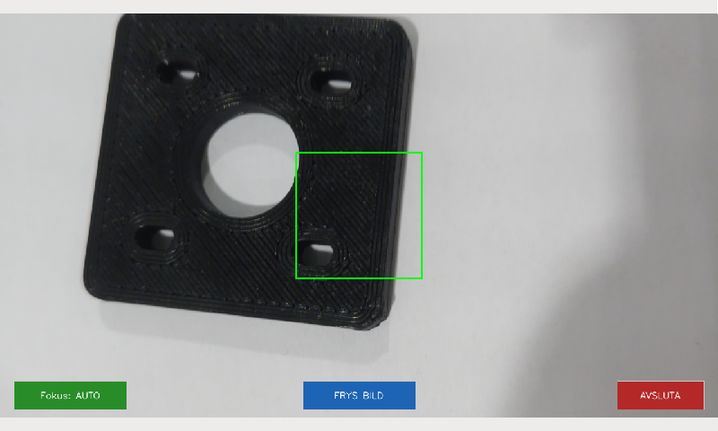
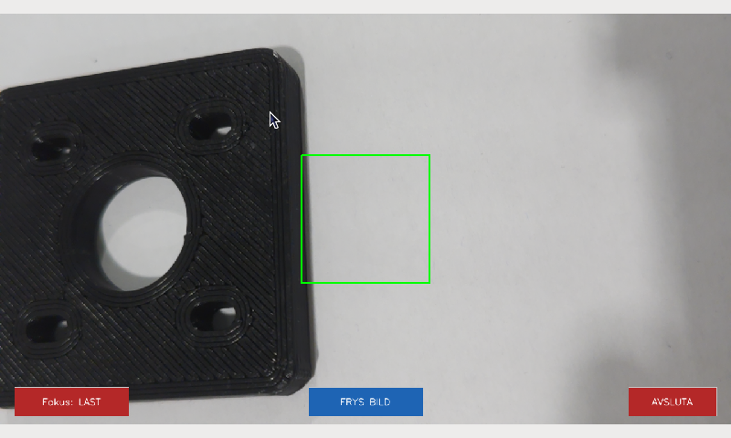
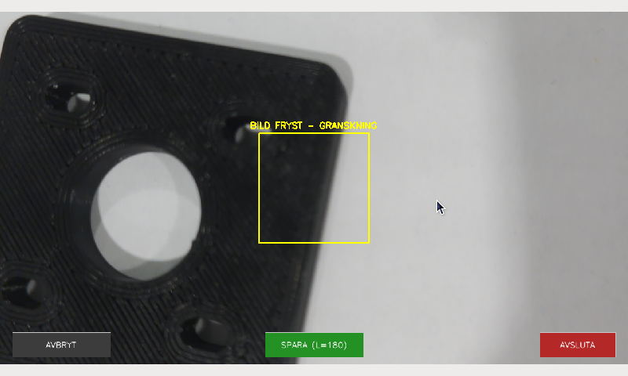

# Camera Calibration For Skin Lesion Scanner

> **A Low-Cost, Standardized Edge-AI Imaging Station for Early Dermatological Triage**  
> Developed for Raspberry Pi 5, Camera Module 3 (Sony IMX708), and a 7" Touchscreen UI.

---

## Executive Summary: The Clinical Problem

Malignant melanoma is among the most aggressive forms of cancer, yet survival rates exceed 95% when detected in its earliest stages. Today’s diagnostic workflow in primary healthcare relies heavily on two extremes, both suffering from severe systemic bottlenecks:

1. **Manual Visual Inspection (Analogue Dermatoscopy):**  
   General practitioners (GPs) inspect suspicious moles with handheld optical dermatoscopes using subjective guidelines (ABCD criteria). Diagnostic accuracy varies heavily depending on practitioner experience, leading to high rates of unnecessary excisions or, worse, delayed specialist referrals.
2. **Proprietary Hospital Rigs & Smartphone Attachments:**  
   High-end clinical dermatoscopy setups cost tens of thousands of euros and are confined to specialist dermatology clinics with long waiting times. Conversely, commercial smartphone lens attachments introduce uncontrolled focal lengths, disparate sensor color profiles, and inconsistent ambient illumination—rendering images unsuitable for reproducible artificial intelligence (AI) inference.

---

## The Solution: Why This Replaces & Modernizes Current Practice

The **Autonomous Embedded Skin Lesion Scanner** bridges the gap between expensive clinical imaging systems and unreliable consumer devices. It is a fully self-contained, standalone medical edge device designed for **Point-of-Care (PoC) primary triage**.

Instead of outsourcing analysis or relying on variable phone cameras, this system enforces **physical and algorithmic standardization at the moment of capture**:

| Feature | Conventional Handheld Dermatoscope | Smartphone AI Apps | **Our Embedded Scanner** |
| :--- | :--- | :--- | :--- |
| **Color Calibration** | None (subjective visual interpretation) | None to poor (inconsistent auto-white-balance) | **Real-time Gray World calibration** against an achromatic optical boundary |
| **Exposure Control** | Manual / uncontrolled ambient drift | Mobile auto-exposure (prone to clipping/highlights) | **Linear Luminance Standardization** ($L=180 / 255$, ETTR-based headroom) |
| **Image Resolution & Crop** | Full wide-angle image requiring manual crop | Variable aspect ratios & digital zoom artifacts | **Direct hardware-locked $224 \times 224$ ROI extraction** for neural networks |
| **Workflow & Usability** | Requires trained specialist review | Requires companion apps, pairing, and cloud uploads | **1-Touch Standalone Terminal** with instant freeze, review, and lock controls |
| **Cost & Scalability** | €1,000 – €15,000+ per unit | Variable consumer hardware; non-standardized | **< €180 in off-the-shelf, open hardware** |

---

## Hardware Stack

- **SBC:** Raspberry Pi 5 (8GB)
- **Sensor:** Raspberry Pi Camera Module 3 (Sony IMX708, PDAF autofocus)
- **Display:** Official Raspberry Pi 7" Touchscreen Display
- **Enclosure:** Custom 3D-printed V5 assembly (`cad/` directory)
- **Optical Mask:** Neutral achromatic white reference aperture

---

## System Architecture

The complete data pipeline—from optical capture on the Sony IMX708 sensor through real-time Gray World color constancy, touchscreen interaction, and post-capture luminance scaling—is structured as follows:


---

## User Interface & Touch Operation

The system is operated via a fullscreen 7-inch capacitive touchscreen interface featuring three persistent touch buttons: **[FOKUS]**, **[FRYS BILD]**, and **[AVSLUTA]**.

| Live Startup View | Autofocus Locked View | Frozen Inspection View |
| :---: | :---: | :---: |
|  |  |  |
| *Initial preview stream with active white reference aperture and 224x224 ROI box.* | *Active PDAF lens lock to prevent focal drift during clinical capture.* | *Frame frozen in memory for quality check before saving or discarding.* |

---

## Empirical Validation: Exposure Invariance & Proxy Testing

To evaluate the robustness of the dual-stage calibration pipeline under extreme environmental shifts, paired trials were conducted using a blue ink proxy marker on skin framed by the white reference aperture.

| Test Run | Low Light (Dark Environment) | High Light (Bright Environment) | Evaluation |
| :--- | :---: | :---: | :--- |
| **Test 1** | `data/samples/dark1.jpg` | `data/samples/light1.jpg` | Post-capture linear scaling ($target = 180$) successfully eliminates exposure drift. |
| **Test 2** | `data/samples/dark2.jpg` | `data/samples/light2.jpg` | Preserves invariant lesion contrast and background whiteness across environments. |

---

## Getting Started

### Prerequisites

Ensure your Raspberry Pi OS has libcamera and Picamera2 installed:

```bash
sudo apt update
sudo apt install python3-picamera2 python3-opencv python3-numpy
